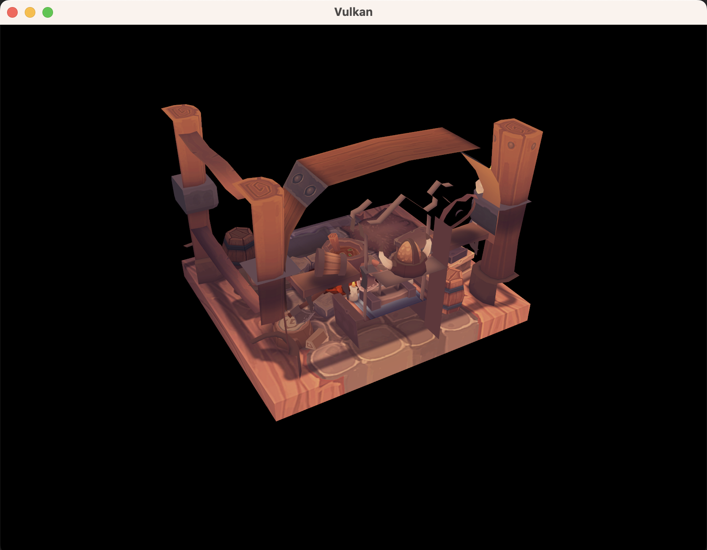
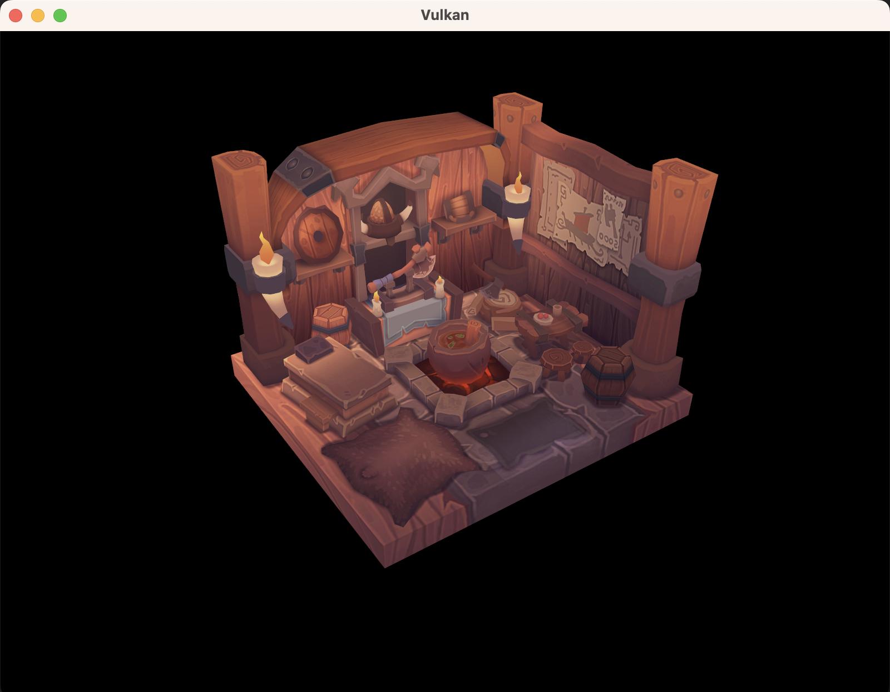

# Introducation
A simple Vulkan based renderer.

## Prerequisites
The engine targets macOS and Windows.

## Quick start
```shell
git clone https://github.com/liamhauw/vulkan-demo.git
cmake -S . -B build
cmake --build build
./bin/main
```

# Result


